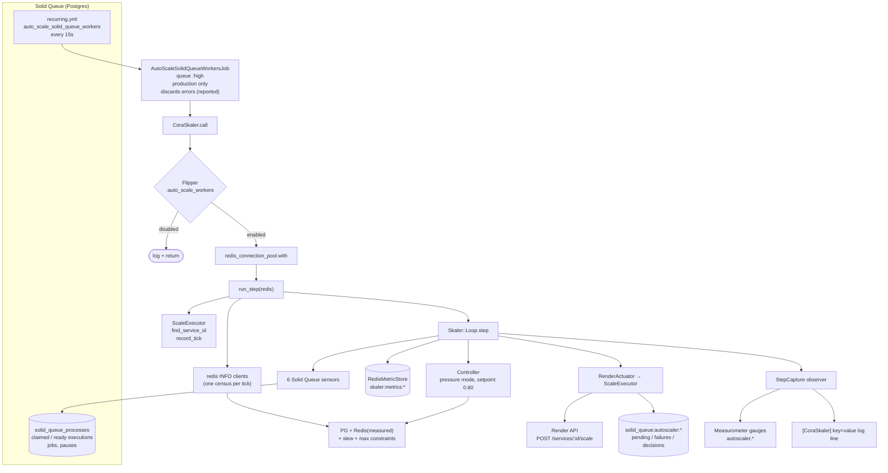
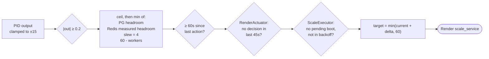

# Example configuration: how Cora runs Skaler

Cora is an email assistant. Its background work runs on Solid Queue: syncing mailboxes, fetching and summarizing messages, sending daily briefs, and handling Gmail push notifications. The workers run as one Render background-worker service, and Skaler decides how many instances it has.

This document describes that setup as one concrete answer to the questions in the README's [Building your own setup](README.md#building-your-own-setup). It isn't a template to copy. Every number here comes from Cora's own traffic, Cora's Postgres and Redis plans, and things that went wrong. Read it for the reasoning, then make your own decisions.

## Cora's workload

- **Bursty.** Mailbox syncs fire on cron and through pub/sub. Daily briefs go out in batches. Each sync fans out into many fetch and processing jobs. During business hours a burst arrives every one to two minutes.
- **Mostly short, I/O-bound jobs**, from tens of milliseconds to a few seconds, with a long tail of slower ones. CPU says almost nothing about load.
- **Shared infrastructure.** Workers share Postgres (through PgBouncer) and one Redis instance with the web tier, Action Cable, a Puppeteer service and ops tooling. Redis has a hard `maxclients` limit of 1000, and that has turned out to be the resource that actually caps the fleet.

## Cora's answers to the seven questions

| Question | Cora's answer |
|----------|---------------|
| Process variable and setpoint | `"pressure"` mode: occupancy plus the bounded backlog term. Setpoint **0.80**, so 20% of capacity is always free to absorb a burst |
| Shared resources | **Postgres** through PgBouncer has a fixed footprint per worker, so it uses `PooledResourceConstraint` with a cap of 2000. **Redis** clients grow with load, so it uses `MeasuredPooledResourceConstraint` against live `INFO clients` at 75% of `maxclients` |
| Growth rate | At most **4** instances per action, at most one scale-up per **60s**, and a **45s** cooldown after any scale command. Instances take about 2-3 minutes to boot |
| Floor and ceiling | **2** instances minimum, **60** maximum. In practice Redis stops growth before 60 |
| Failed readings | Any exception in a step is reported and the tick does nothing. An unreadable Redis census means zero headroom |
| Off switch | Flipper flag `:auto_scale_workers`, checked on every tick |
| Visibility | Gauges for every reading the decision used, measured Redis usage next to `maxclients`, a saturation counter to alert on, and one structured log line per tick |

## How Cora got here

Most of the current settings replaced something that failed. The history is the best explanation of them.

1. **Three autoscalers before Skaler.** These were a queue-depth threshold, then trend analysis, then queue latency with a chain of if/else rules. None of them knew about boot time, so each tick ordered more instances while the last batch was still booting. None of them knew about connection limits either, and one scaled until Postgres ran out of connections. Skaler replaced them with a PID loop, boot-lag tracking and constraints.
2. **Occupancy stalled. Unbounded pressure flapped.** The first PID version used occupancy and settled at its setpoint with 1,220 jobs waiting. Switching to `(busy + ready) / capacity` produced signals above 30 and swings between 5 and 40 instances. The bounded backlog term (`ready / completed`, capped) fixed both.
3. **The PID had no memory.** The loop runs as a job on whichever worker picks it up, so each tick built a new controller with empty history. In effect it was a P controller with an inflated gain. Controller state moved into the Redis metric store.
4. **Ticks were irregular,** anywhere from 60 to 120 seconds or more on a busy fleet. The PID became time-weighted, with a nominal interval taken from the median observed interval. The controller also gained separate observe and act rates.
5. **Threads, then gains.** Render metrics showed workers using about a quarter of their memory and CPU, and PgBouncer made more connections safe. Doubling threads per worker was the biggest improvement in the whole project: in simulation it cut latency about tenfold and cost by about 45%. After that, a parameter sweep chose KP 1.0, KI 0.01, KD 2.0, a deadband of 0.2 (which cut scaling events from 325 to 42 per simulated 12h), setpoint 0.8 and a 45s cooldown.
6. **The capacity reading was noisy.** Production showed raw utilization jumping by 1.0 or more from one minute to the next. Most of that came from capacity readings caught while workers were booting or shutting down, plus readings of zero during deploys. The fixes were a capacity floor of `busy`, skipping ticks with zero capacity, lowering `SMOOTHING_ALPHA` from 0.75 to 0.45 (the knee of an alpha sweep), and running the loop every 15s instead of every 60s.
7. **The floor was too low.** With a floor of 1, a setpoint of 0.95, ungated scale-down and a 180s gate on scale-up, the fleet oscillated 1 → 7 → 1 through every burst. Gmail push messages waited up to 8 minutes. The fix was a higher floor (now 2), setpoint 0.80, and a 60s scale-up gate. It needed no infrastructure changes.
8. **Redis ran out of clients, twice, in one week of September 2026.**
   - The first time, the Redis constraint used `maxclients / 10 per worker`, so it thought the limit was 100 workers. Redis refused connections at 52, while the constraint still showed room for 48 more. Nothing measured actual usage, so the 2× error went unnoticed. The budget was tightened to 20 clients per worker with 200 reserved for non-worker clients, and measurement was added.
   - The tightened budget allowed exactly `(1000 - 200) / 20 = 40` workers, which works out to all 1000 clients at that ceiling. The fleet reached it, and Redis sat at its limit for 11 minutes. The new measurements showed why: the clients each worker added ranged from about 5 at idle to about 15 on a ramp and about 24 near saturation. Connection pools fill lazily, and a semaphore holding blocking reads inside a pooled connection made the pools grow further as Redis slowed down. No per-worker constant could have been right.
   - The fix was to measure: a closed-loop constraint at 75% of `maxclients`, a slew limit of 4, the per-instance Redis pool capped at 12, and charts of `maxclients` and a saturation counter. The dashboard had also hidden the problem: an hourly gauge rollup showed 797 clients during the hour Redis was refusing connections.
9. **Pooler detection.** The Postgres cap depends on whether Cora connects through a pooler. That used to be detected by the substring `bouncer` in the hostname. A managed pooler keeps the database hostname and only changes the port, and the autoscaler would have silently assumed a sixth of its real budget. Detection now checks the port as well.

## The moving parts



## Scheduling and the off switch

```yaml
# config/recurring.yml
auto_scale_solid_queue_workers:
  schedule: "0,15,30,45 * * * * *" # Every 15 seconds
  class: "AutoScaleSolidQueueWorkersJob"
```

```ruby
# app/jobs/auto_scale_solid_queue_workers_job.rb
class AutoScaleSolidQueueWorkersJob < ApplicationJob
  queue_as :high

  # A broken loop (bad Render token, say) would pile up retries faster than
  # they drain at a 15s cadence - drop the tick, report it, let the next one try
  discard_with_appsignal_reporting_on StandardError

  def perform
    return unless Rails.env.production?
    CoraSkaler.call
  end
end
```

The job runs on `:high` so that a backed-up `default` queue does not delay the autoscaler, since that backlog is exactly what it reacts to. Its class name is left over from an earlier autoscaler and stays because existing recurring-task rows refer to it.

`Flipper.disable(:auto_scale_workers)` stops all scaling on the next tick, with no deploy. The fleet stays at whatever size it had. Operators switched it off during the second Redis incident.

## The constants

All of these live in `CoraSkaler`:

```ruby
module CoraSkaler
  KP = 1.0
  KI = 0.01
  KD = 2.0
  DEADBAND = 0.2
  SETPOINT = 0.80
  SMOOTHING_ALPHA = 0.45
  METRIC_MODE = "pressure"

  SERVICE_NAME = "cora-solid-queue-worker"
  MIN_INSTANCES = 2
  MAX_INSTANCES = 60
  COOLDOWN_UP = 45
  COOLDOWN_DOWN = 45
  MIN_ACTION_INTERVAL_UP = 60
  MIN_ACTION_INTERVAL_DOWN = 0

  PG_CONNECTION_CAP = 2000
  REDIS_POOL_PER_WORKER = 20
  REDIS_TARGET_UTILIZATION = 0.75
  MAX_SCALE_UP_STEP = 4
end
```

| Constant | Why it has this value | History |
|----------|-----------------------|---------|
| `KP / KI / KD = 1.0 / 0.01 / 2.0` | Chosen in simulator sweeps. Raising KP from 0.5 and KD from 1.0 made scaling more responsive without oscillation. KI stays small, so P and D do most of the work | 5 |
| `DEADBAND = 0.2` | Prevents ±1-instance churn around the setpoint | 5 |
| `SETPOINT = 0.80` | Leaves capacity free, so ordinary bursts don't trigger a scale-up cycle | 7 |
| `SMOOTHING_ALPHA = 0.45` | The knee of the alpha sweep: as few peak instances as 0.75, with much less noise | 6 |
| `METRIC_MODE = "pressure"` | Occupancy stalls at 1.0 while Cora's backlog grows | 2 |
| `MIN_INSTANCES = 2` | A warm floor, so steady load never waits on a cold start | 7 |
| `MAX_INSTANCES = 60` | The budget ceiling. It also sets the per-instance Redis pool width, see below | 8 |
| `COOLDOWN_UP/DOWN = 45` | Stops consecutive 15s ticks from sending Render overlapping scale calls | 5 |
| `MIN_ACTION_INTERVAL_UP = 60` | Gives new instances time to start pulling jobs before more are ordered | 7 |
| `MIN_ACTION_INTERVAL_DOWN = 0` | Scale-down is ungated, so frequent bursts can't ratchet the fleet up | 4 |
| `PG_CONNECTION_CAP = 2000` | PgBouncer's client limit. Without a detected pooler, the sensor falls back to 350 | 1, 9 |
| `REDIS_POOL_PER_WORKER = 20` | Only converts measured slack into an instance count, so it has to be an _upper bound_ on what one more instance adds. Overestimating only makes each step smaller | 8 |
| `REDIS_TARGET_UTILIZATION = 0.75` | Keeps the ceiling below the edge. Measured usage includes every client, so no separate reserve is needed | 8 |
| `MAX_SCALE_UP_STEP = 4` | The PID can ask for 15 instances, about 300 new Redis clients before the next reading. 4 keeps an overshoot within what the next tick can correct | 8 |

The History column refers to the numbered steps above.

### Infrastructure settings that have to agree with these

- `config/queue.yml` runs `threads: RAILS_MAX_THREADS` in one worker process per instance. `ThreadsPerWorkerSensor` reads the thread count back from the worker's heartbeat metadata, so capacity follows whatever is deployed.
- `config/database.yml` sets `pool: RAILS_MAX_THREADS + 2` (the extra two are for the dispatcher and scheduler). The Postgres constraint uses that pool size as each worker's share.
- `config/application.rb` caps the shared Redis `ConnectionPool` at **12 per instance**. That comes from `1000 maxclients / 60 MAX_INSTANCES ≈ 16`, minus a margin for web, Puppeteer, ops and deploy overlap. It is a literal on purpose, not an env var: a pool that can be widened in production can be widened past `maxclients`. **If `MAX_INSTANCES` or the Redis plan changes, change this number too.**

In practice the fleet tops out around 40-45 workers, limited by Redis rather than by `MAX_INSTANCES`. To raise it, upgrade the Redis plan or reduce clients per instance. Don't loosen the constraint.

## The loop as Cora builds it

```ruby
def run_step(redis)
  executor = Skaler::ScaleExecutor.new(redis: redis)
  service_id = executor.find_service_id(service_name: SERVICE_NAME)
  return logger.warn("[CoraSkaler] Could not find Render service") unless service_id

  # Boot-lag bookkeeping has to run before the loop decides anything
  active_workers = Skaler::ActiveWorkersSensor.new.take_measurement
  executor.record_tick(active_sq_workers: active_workers)

  # One INFO snapshot per tick, shared by the constraint and the gauges,
  # so the dashboard shows the numbers the controller acted on
  info = redis.info("clients")
  clients = {connected: info.fetch("connected_clients").to_i, maxclients: info.fetch("maxclients").to_i}

  capture = StepCapture.new # plain #on_step observer that keeps the last call
  result = build_loop(redis:, executor:, service_id:, observer: capture, clients:).step

  report_gauges(capture, instances: executor.instance_count(service_id: service_id), clients: clients)
  log_step(capture)
  result
rescue => e
  Appsignal.report_error(e)
  nil # a failed read means no scaling, which is the safe default
end

def build_loop(redis:, executor:, service_id:, observer:, clients:)
  Skaler::Loop.new(
    sensors: {
      active_workers: Skaler::ActiveWorkersSensor.new,
      threads_per_worker: Skaler::ThreadsPerWorkerSensor.new,
      capacity: Skaler::CapacitySensor.new,
      claimed_jobs: Skaler::ClaimedJobsSensor.new,   # read as busy_threads
      ready_jobs: Skaler::ReadyJobsSensor.new,
      completed_jobs: Skaler::CompletedJobsSensor.new(since: completed_since_callable(redis))
    },
    store: Skaler::RedisMetricStore.new(redis: redis, key_prefix: "skaler:metrics"),
    controller: Skaler::Controller.new(
      pid: Skaler::PidController.new(kp: KP, ki: KI, kd: KD, deadband: DEADBAND),
      constraints: [
        Skaler::PooledResourceConstraint.new(
          cap: PG_CONNECTION_CAP,
          pool_per_worker: ActiveRecord::Base.connection_pool.size,
          name: :pg
        ),
        Skaler::MeasuredPooledResourceConstraint.new(
          usage: clients.fetch(:connected),
          cap: clients.fetch(:maxclients),
          pool_per_worker: REDIS_POOL_PER_WORKER,
          target_utilization: REDIS_TARGET_UTILIZATION,
          name: :redis
        ),
        Skaler::SlewRateConstraint.new(max_step: MAX_SCALE_UP_STEP),
        Skaler::MaxInstancesConstraint.new(max: MAX_INSTANCES)
      ],
      setpoint: SETPOINT,
      smoothing_alpha: SMOOTHING_ALPHA,
      metric_mode: METRIC_MODE,
      min_action_interval_up: MIN_ACTION_INTERVAL_UP,
      min_action_interval_down: MIN_ACTION_INTERVAL_DOWN
    ),
    actuator: Skaler::RenderActuator.new(
      executor: executor, service_id: service_id,
      min_instances: MIN_INSTANCES, max_instances: MAX_INSTANCES,
      cooldown_up: COOLDOWN_UP, cooldown_down: COOLDOWN_DOWN
    ),
    observer: observer
  )
end
```

`completed_since_callable` stores the previous tick's cutoff in Redis (`skaler:completed_jobs:last_t`), so each tick counts each completion exactly once. The cutoff uses the app clock rather than Redis `TIME`, because it is compared with `finished_at`, which Rails writes with the app clock.

### How a scale-up is gated

A positive PID output has to get through every layer below before Render is called:



A scale-down only has to clear the deadband, the 45s cooldown and `MIN_INSTANCES`.

## Redis keys

| Key | Owner | Contents | Lifetime |
|-----|-------|----------|----------|
| `skaler:metrics:timeseries` | `RedisMetricStore` | sorted set of JSON measurement hashes, scored by Redis `TIME` | pruned to 30 min |
| `skaler:metrics:controller_state` | `RedisMetricStore` | EMA, signal history (≤60 entries), `last_action_at` | 1h TTL |
| `skaler:completed_jobs:last_t` | `CoraSkaler` | completion window cutoff | none |
| `solid_queue:autoscaler:executor:pending_target` / `pending_since` | `ScaleExecutor` | outstanding scale-up | cleared on arrival or timeout |
| `solid_queue:autoscaler:executor:consecutive_failures` | `ScaleExecutor` | boot timeouts in a row | reset on success |
| `solid_queue:autoscaler:executor:backoff_until` | `ScaleExecutor` | scale-ups blocked until this time | 10 min after the 3rd failure |
| `solid_queue:autoscaler:decisions` | `ScaleExecutor` | sorted set of recent scale commands, used for cooldowns | pruned to 30 min |

To reset the controller's memory after a large change to the gains, delete `skaler:metrics:controller_state`. The next tick starts with an empty integral and an EMA of zero.

## Observability

Gauges are sent through `Measurometer` to AppSignal:

| Metric | When |
|--------|------|
| `autoscaler.claimed`, `.ready`, `.capacity`, `.completed_since_last`, `.instances`, `.solid_queue_workers` | every tick |
| `autoscaler.headroom_pg`, `.headroom_redis`, `.max_additional` | every tick |
| `autoscaler.pg_current`, `.redis_current` | every tick. These are the _modelled_ usage (workers × pool), kept for comparison |
| `autoscaler.redis_connected`, `.redis_maxclients`, `.redis_utilization` | every tick. These are _measured_. If `redis_current` and `redis_connected` diverge, `REDIS_POOL_PER_WORKER` is wrong |
| `autoscaler.redis_saturation_ticks` (counter) | ticks at or above 75% of `maxclients`. A counter, so hourly rollups can't hide it. **Alert on this one** |
| `autoscaler.utilization_raw`, `.utilization_smoothed`, `.setpoint`, `.error`, `.pid_p/i/d`, `.pid_output` | only on ticks where the PID actually ran, so skipped ticks don't report zeros |
| `autoscaler.instance_change_pulse` (distribution) | each scale command |

Each step writes one log line. Skipped ticks give the reason:

```
[CoraSkaler] pv=0.8123 raw=0.9010 sp=0.80 error=0.0123 out_p=0.0123 out_i=0.0011 out_d=0.0440 output=0.0574 delta=0 result=noop workers=6 claimed=61 ready=4 completed=230 capacity=72 headroom_pg=136 headroom_redis=8 redis_util=0.62
[CoraSkaler] skip reason=skipped_tick dt=1.3s workers=6 claimed=58 capacity=72 headroom_pg=136 headroom_redis=8
```

## Re-tuning

Export Cora's per-minute enqueue counts and job durations from AppSignal in the formats described in the README. Then replay them with production settings. The simulator's defaults differ from production in `--alpha`, `--threads` and the tick interval, so set those explicitly:

```sh
bundle exec exe/skaler_sim \
  --ingress-csv enqueues_per_minute.csv --durations job_durations.csv \
  --kp 1.0 --ki 0.01 --kd 2.0 --setpoint 0.8 --deadband 0.2 \
  --alpha 0.45 --mode pressure \
  --workers 2 --max-workers 60 --threads 12 \
  --interval 15s --boot-lag 3m --cooldown 45s
```

Change one value per run. Compare `cost` (instance-minutes) with `avg p95` queue latency. Lower is better for both, and the choice is where to land between them. The simulator models the Redis constraint open-loop, so check any change that lets the fleet grow against the measured `redis_connected` series before shipping it.

## Moving Cora onto this gem

Cora still has its own copy of this code in `app/services/skaler/`. The gem is the same code with its Rails dependencies passed in as arguments instead, so switching is a small change:

1. Add the gem, then delete `app/services/skaler/` and its tests. Keep `app/services/cora_skaler.rb` and its test.
2. In an initializer: `require "skaler/solid_queue"` and `Skaler.logger = Rails.logger`.
3. Construct `ScaleExecutor` with its clients and event hook passed in:
   ```ruby
   Skaler::ScaleExecutor.new(
     render_client: RenderClient.new,
     redis: redis,
     on_scale: ->(by_n:, direction:, timestamp:) {
       ActiveSupport::Notifications.instrument("instance_change.autoscaler", by_n:, direction:, timestamp:)
       Measurometer.add_distribution_value("autoscaler.instance_change_pulse", by_n)
     }
   )
   ```
4. To keep reading through the read-only model: `Skaler::ReadyJobsSensor.new(model: SolidQueueReadyExecution)`.
5. `bin/skaler_sim` becomes `bundle exec skaler_sim`, which no longer boots Rails.
