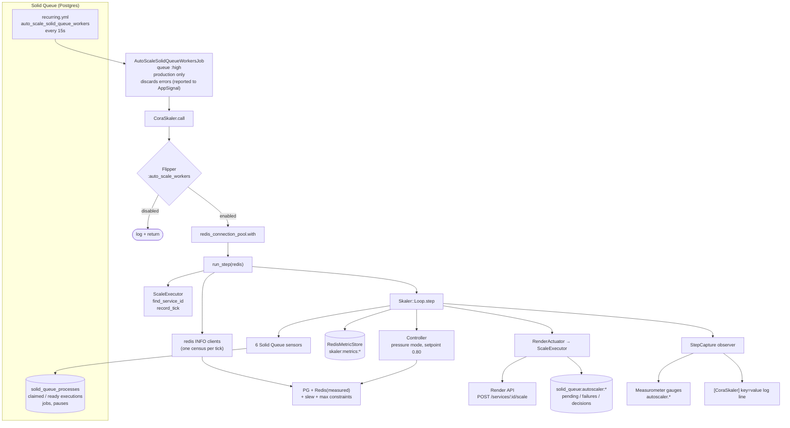
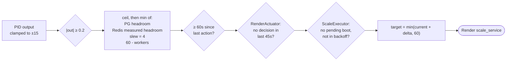

# Example configuration: the Cora autoscaler

This is how Cora runs Skaler in production. Cora scales the `cora-solid-queue-worker` Render service, which runs Solid Queue workers. Cora still carries its own copy of the code (`app/services/skaler/`, `app/services/cora_skaler.rb`). The last section explains how to switch it over to this gem.

## The moving parts



## Scheduling

```yaml
# config/recurring.yml
auto_scale_solid_queue_workers:
  schedule: "0,15,30,45 * * * * *" # Every 15 seconds
  class: "AutoScaleSolidQueueWorkersJob"
```

```ruby
# app/jobs/auto_scale_solid_queue_workers_job.rb
class AutoScaleSolidQueueWorkersJob < ApplicationJob
  queue_as :high

  # A broken loop (bad Render token, say) would pile up retries faster than
  # they drain at a 15s cadence - drop the tick, report it, let the next one try
  discard_with_appsignal_reporting_on StandardError

  def perform
    return unless Rails.env.production?
    CoraSkaler.call
  end
end
```

The job's class name is a leftover from the old autoscaler. It stays because existing `solid_queue_recurring_tasks` rows refer to it.

The job runs on `:high`, so `default` backing up does not delay the autoscaler, and that backlog is exactly what it reacts to. A 15-second tick is fine because the controller does not assume a fixed interval. It normalizes `dt` by the median observed tick interval and skips ticks that arrive less than 2s apart.

### Kill switch

```yaml
# config/flipper_flag_defaults.yml
auto_scale_workers:
  enabled: true
```

`Flipper.disable(:auto_scale_workers)` stops all scaling on the next tick, with no deploy. The fleet stays at whatever size it had.

## The tuning constants

All of these live in `CoraSkaler`. Each value has a reason behind it, and most of the reasons are incidents:

```ruby
module CoraSkaler
  # PID, tuned in the simulator
  KP = 1.0
  KI = 0.01
  KD = 2.0
  DEADBAND = 0.2
  SETPOINT = 0.80          # below 1.0 so short bursts are absorbed by standing headroom

  SMOOTHING_ALPHA = 0.45
  METRIC_MODE = "pressure" # backlog counts, not just busy threads

  SERVICE_NAME = "cora-solid-queue-worker"
  MIN_INSTANCES = 2        # warm floor for steady state, no cold start for the baseline
  MAX_INSTANCES = 60
  COOLDOWN_UP = 45
  COOLDOWN_DOWN = 45

  REDIS_POOL_PER_WORKER = 20       # upper bound on clients one more instance adds
  REDIS_TARGET_UTILIZATION = 0.75  # fleet may occupy at most 75% of maxclients
  MAX_SCALE_UP_STEP = 4            # slew limit per action
  PG_CONNECTION_CAP = 2000         # behind PgBouncer

  MIN_ACTION_INTERVAL_UP = 60      # act on scale-up at most once a minute
  MIN_ACTION_INTERVAL_DOWN = 0     # scale-down is ungated, so the fleet cannot ratchet up
end
```

| Constant | What it does | Why it has this value |
|----------|--------------|-----------------------|
| `KP / KI / KD` | PID gains | Picked with `skaler_sim` sweeps (see `docs/plans/*skaler*` in Cora). Raising KP from 0.5 to 1.0 and KD from 1.0 to 2.0 made scaling more responsive without causing oscillation. KI stays small, so P and D do most of the work. |
| `DEADBAND = 0.2` | ignore small outputs | Stops ±1-instance flapping around the setpoint. |
| `SETPOINT = 0.80` | target pressure | Leaves headroom, so a burst inside one tick doesn't immediately set off a scale-up cycle. |
| `SMOOTHING_ALPHA = 0.45` | EMA weight of the newest sample | At a 15s tick the time constant is about half a minute. Earlier, with 0.75, a single bad sample could move the EMA most of the way on its own. |
| `METRIC_MODE = "pressure"` | adds `ready / completed` to utilization | Utilization tops out at 1.0, and Cora's backlog builds up while the fleet is already saturated. |
| `MIN_INSTANCES = 2` | actuator floor | Absorbs steady load without waiting on a cold start. Revisit if `RAILS_MAX_THREADS` or the pull job's concurrency limits change. |
| `MAX_INSTANCES = 60` | ceiling (actuator and `MaxInstancesConstraint`) | Also determines the Redis pool width, see below. |
| `COOLDOWN_UP/DOWN = 45` | `RenderActuator` cooldown after any decision | Set during the same retuning as the gains. It stops consecutive 15s ticks from sending Render overlapping scale calls. |
| `MIN_ACTION_INTERVAL_UP = 60` | controller-level hold | Gives booted instances a chance to start pulling jobs before the controller asks for more. |
| `REDIS_POOL_PER_WORKER = 20` | converts measured Redis slack into instances | This needs to be an _upper bound_ on the marginal cost, not an average. Overestimating only makes each step smaller. Incidents #2106 and #2123 came from this number being wrong in opposite directions. |
| `REDIS_TARGET_UTILIZATION = 0.75` | margin under `maxclients` | Incident #2123 (2026-09-21) used up Redis at the modelled ceiling, because the open-loop budget had allocated all of `maxclients`. |
| `MAX_SCALE_UP_STEP = 4` | `SlewRateConstraint` | The PID can ask for up to 15 instances. At 20 clients each, that is about 300 new Redis clients arriving before the next measurement can see them. |
| `PG_CONNECTION_CAP = 2000` | PG budget | Cora connects through PgBouncer. Without a pooler the safe cap is 350, which is what `PgConnectionCapSensor` falls back to. |

### Infrastructure settings that have to agree with these

- `config/queue.yml`: `threads: RAILS_MAX_THREADS` (default 12) per worker process, with one process per instance. `ThreadsPerWorkerSensor` reads this back from the `thread_pool_size` key in the worker's metadata.
- `config/database.yml`: `pool: RAILS_MAX_THREADS + 2` (for the dispatcher and scheduler). The PG constraint uses `ActiveRecord::Base.connection_pool.size` as each worker's share.
- `config/application.rb`: the shared Redis `ConnectionPool` is sized at 12 per instance, from `1000 maxclients / 60 MAX_INSTANCES ≈ 16`, minus a margin for web, Puppeteer, ops and deploy overlap. This is a literal on purpose, not an env var: a pool that can be widened in production can be widened past `maxclients`. **If `MAX_INSTANCES` or the Redis plan changes, change this number too.**

## The loop as Cora builds it

```ruby
def run_step(redis)
  executor = Skaler::ScaleExecutor.new(redis: redis)   # gem: also render_client:, on_scale:
  service_id = executor.find_service_id(service_name: SERVICE_NAME)
  return logger.warn("[CoraSkaler] Could not find Render service") unless service_id

  # Boot-lag bookkeeping has to run before the loop decides anything
  active_workers = Skaler::ActiveWorkersSensor.new.take_measurement
  executor.record_tick(active_sq_workers: active_workers)

  # One INFO snapshot per tick, shared by the constraint and the gauges,
  # so the dashboard shows the numbers the controller acted on
  info = redis.info("clients")
  clients = {connected: info.fetch("connected_clients").to_i, maxclients: info.fetch("maxclients").to_i}

  capture = StepCapture.new # plain #on_step observer that stores the last call
  result = build_loop(redis:, executor:, service_id:, observer: capture, clients:).step

  report_gauges(capture, instances: executor.instance_count(service_id: service_id), clients: clients)
  log_step(capture)
  result
rescue => e
  Appsignal.report_error(e)
  nil # a failed read means no scaling, which is the safe default
end
```

```ruby
def build_loop(redis:, executor:, service_id:, observer:, clients:)
  Skaler::Loop.new(
    sensors: {
      active_workers: Skaler::ActiveWorkersSensor.new,
      threads_per_worker: Skaler::ThreadsPerWorkerSensor.new,
      capacity: Skaler::CapacitySensor.new,
      claimed_jobs: Skaler::ClaimedJobsSensor.new,   # read as busy_threads
      ready_jobs: Skaler::ReadyJobsSensor.new,
      completed_jobs: Skaler::CompletedJobsSensor.new(since: completed_since_callable(redis))
    },
    store: Skaler::RedisMetricStore.new(redis: redis, key_prefix: "skaler:metrics"),
    controller: Skaler::Controller.new(
      pid: Skaler::PidController.new(kp: KP, ki: KI, kd: KD, deadband: DEADBAND),
      constraints: [
        Skaler::PooledResourceConstraint.new(
          cap: PG_CONNECTION_CAP,
          pool_per_worker: ActiveRecord::Base.connection_pool.size,
          name: :pg
        ),
        Skaler::MeasuredPooledResourceConstraint.new(
          usage: clients.fetch(:connected),
          cap: clients.fetch(:maxclients),
          pool_per_worker: REDIS_POOL_PER_WORKER,
          target_utilization: REDIS_TARGET_UTILIZATION,
          name: :redis
        ),
        Skaler::SlewRateConstraint.new(max_step: MAX_SCALE_UP_STEP),
        Skaler::MaxInstancesConstraint.new(max: MAX_INSTANCES)
      ],
      setpoint: SETPOINT,
      smoothing_alpha: SMOOTHING_ALPHA,
      metric_mode: METRIC_MODE,
      min_action_interval_up: MIN_ACTION_INTERVAL_UP,
      min_action_interval_down: MIN_ACTION_INTERVAL_DOWN
    ),
    actuator: Skaler::RenderActuator.new(
      executor: executor, service_id: service_id,
      min_instances: MIN_INSTANCES, max_instances: MAX_INSTANCES,
      cooldown_up: COOLDOWN_UP, cooldown_down: COOLDOWN_DOWN
    ),
    observer: observer
  )
end
```

`completed_since_callable` stores a "last cutoff" timestamp in Redis (`skaler:completed_jobs:last_t`). Each tick counts only the completions since the previous tick, so overlapping windows don't count the same jobs twice. The cutoff uses the app clock (`Time.current`) rather than Redis `TIME`, because it is compared with `finished_at`, which Rails writes with the app clock.

### How a scale-up is gated

A positive PID output has to get through every layer below before Render is called:



A scale-down only has to clear the deadband, the 45s cooldown and `MIN_INSTANCES`.

## Redis keys

| Key | Owner | Contents | Lifetime |
|-----|-------|----------|----------|
| `skaler:metrics:timeseries` | `RedisMetricStore` | sorted set of JSON measurement hashes, scored by Redis `TIME` | pruned to 30 min |
| `skaler:metrics:controller_state` | `RedisMetricStore` | EMA, signal history (≤60 entries), `last_action_at` | 1h TTL |
| `skaler:completed_jobs:last_t` | `CoraSkaler` | completion window cutoff | none |
| `solid_queue:autoscaler:executor:pending_target` / `pending_since` | `ScaleExecutor` | outstanding scale-up | cleared on arrival or timeout |
| `solid_queue:autoscaler:executor:consecutive_failures` | `ScaleExecutor` | boot timeouts in a row | reset on success |
| `solid_queue:autoscaler:executor:backoff_until` | `ScaleExecutor` | scale-ups blocked until this time | 10 min after the 3rd failure |
| `solid_queue:autoscaler:decisions` | `ScaleExecutor` | sorted set of recent scale commands, used for cooldowns | pruned to 30 min |

To reset the controller's memory, for example after a large change to the gains, delete `skaler:metrics:controller_state`. The next tick starts with an empty integral and an EMA of zero.

## Observability

Gauges are sent through `Measurometer`, which forwards them to AppSignal:

| Gauge | When |
|-------|------|
| `autoscaler.claimed`, `.ready`, `.capacity`, `.completed_since_last`, `.instances`, `.solid_queue_workers` | every tick |
| `autoscaler.headroom_pg`, `.headroom_redis`, `.max_additional` | every tick |
| `autoscaler.pg_current`, `.redis_current` | every tick. These are the _modelled_ usage (workers × pool) |
| `autoscaler.redis_connected`, `.redis_maxclients`, `.redis_utilization` | every tick. These are _measured_. If `redis_current` drifts away from `redis_connected`, `REDIS_POOL_PER_WORKER` is wrong |
| `autoscaler.redis_saturation_ticks` (counter) | ticks at or above 75% of maxclients. This is a counter rather than a gauge so it survives hourly rollups. **Alert on this one** |
| `autoscaler.utilization_raw`, `.utilization_smoothed`, `.setpoint`, `.error`, `.pid_p/i/d`, `.pid_output` | only on ticks where the PID actually ran, so skipped ticks don't report zeros |
| `autoscaler.instance_change_pulse` (distribution) | each scale command, from `ScaleExecutor` |

Each step writes one log line:

```
[CoraSkaler] pv=0.8123 raw=0.9010 sp=0.80 error=0.0123 out_p=0.0123 out_i=0.0011 out_d=0.0440 output=0.0574 delta=0 result=noop workers=6 claimed=61 ready=4 completed=230 capacity=72 headroom_pg=136 headroom_redis=8 redis_util=0.62
[CoraSkaler] skip reason=skipped_tick dt=1.3s workers=6 claimed=58 capacity=72 headroom_pg=136 headroom_redis=8
```

Scale commands also fire `instance_change.autoscaler` through `ActiveSupport::Notifications`, so you can subscribe to them, for example for Slack. Nothing in Cora subscribes to it yet.

## Re-tuning with the simulator

The `skaler_sim` defaults are close to Cora's production values. They differ in `--alpha` (0.75 in the simulator, 0.45 in production), `--threads` (10 vs. 12) and the tick interval (60s vs. 15s). Set those explicitly when you want a like-for-like run:

```sh
bundle exec exe/skaler_sim \
  --ingress-csv enqueues_per_minute.csv --durations job_durations.csv \
  --kp 1.0 --ki 0.01 --kd 2.0 --setpoint 0.8 --deadband 0.2 \
  --alpha 0.45 --mode pressure \
  --workers 2 --max-workers 60 --threads 12 \
  --interval 15s --boot-lag 3m --cooldown 45s
```

Build `enqueues_per_minute.csv` from AppSignal's per-minute enqueue counts, with one column per job class. Build `job_durations.csv` from the background-action metrics (`action,mean_ms,p90_ms`). Change one gain per run and compare `cost` (instance-minutes) with `avg p95` queue latency. Lower is better for both, and you are choosing where to land between them.

## Moving Cora onto this gem

The gem's code is Cora's code with the Rails coupling made injectable. The diff for Cora is small:

1. Add `gem "skaler", path: "../skaler"` (or a git source), then delete `app/services/skaler/` and its tests. Keep `app/services/cora_skaler.rb` and its test.
2. In an initializer: `require "skaler/solid_queue"` and `Skaler.logger = Rails.logger`.
3. `ScaleExecutor` no longer creates its own clients or emits events. Construct it like this:
   ```ruby
   Skaler::ScaleExecutor.new(
     render_client: RenderClient.new,
     redis: redis,
     on_scale: ->(by_n:, direction:, timestamp:) {
       ActiveSupport::Notifications.instrument("instance_change.autoscaler", by_n:, direction:, timestamp:)
       Measurometer.add_distribution_value("autoscaler.instance_change_pulse", by_n)
     }
   )
   ```
4. `ReadyJobsSensor` defaults to `SolidQueue::ReadyExecution`. To keep using the read-only model, pass it in: `Skaler::ReadyJobsSensor.new(model: SolidQueueReadyExecution)`.
5. `RedisConnectionsSensor` and `RedisConnectionCapSensor` now require `redis:`. Cora doesn't use them in the loop, so nothing changes there.
6. `bin/skaler_sim` becomes `bundle exec skaler_sim`. It no longer boots Rails, so it starts instantly.
