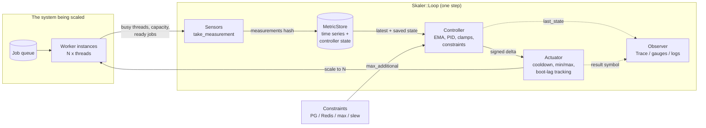
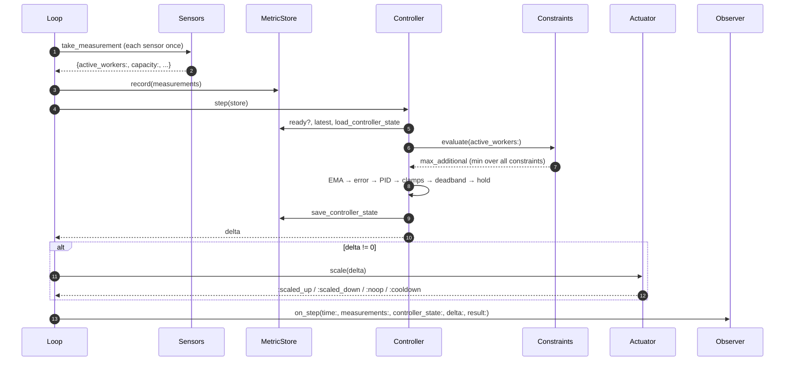
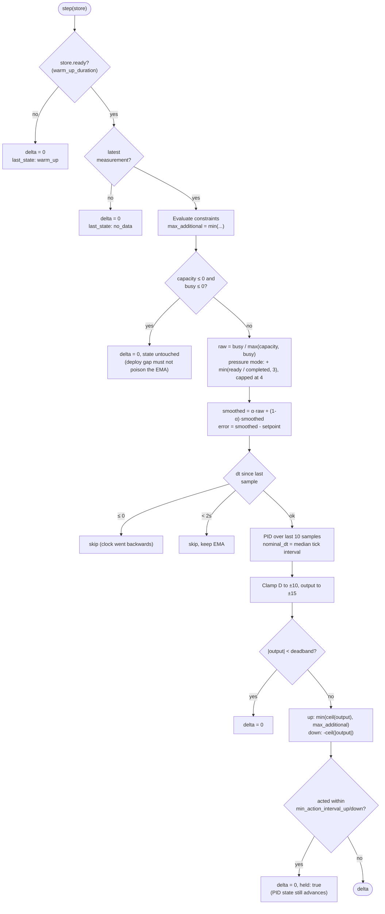
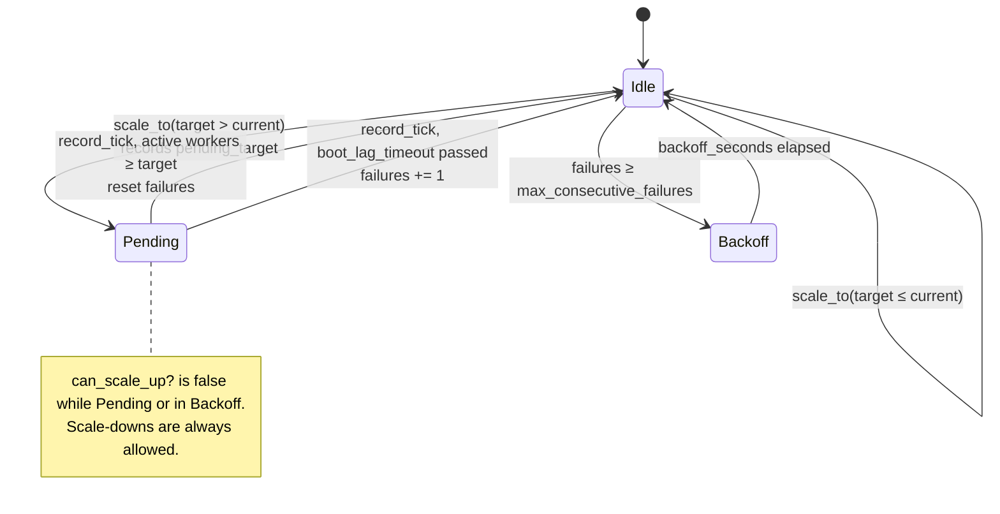
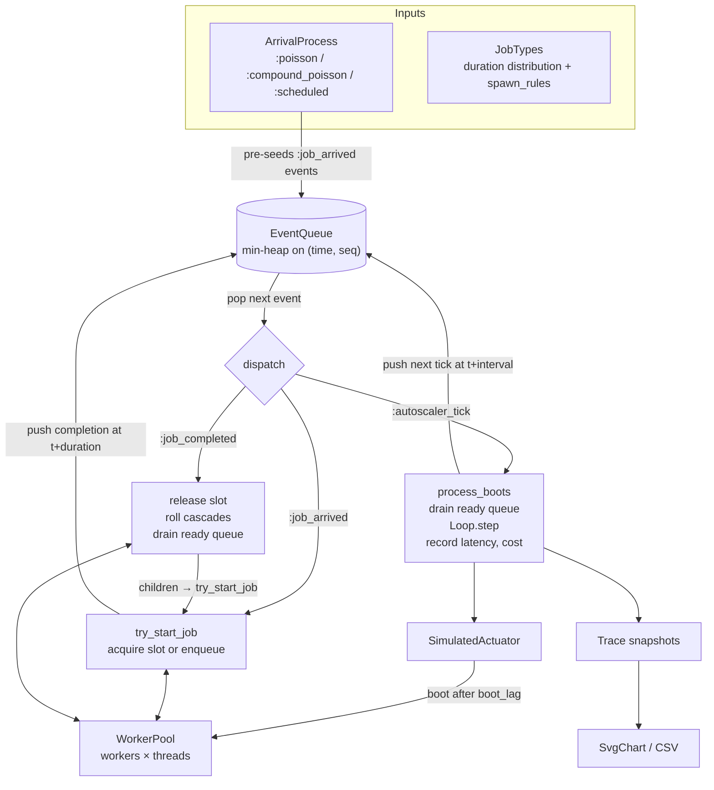

# Skaler

Skaler is a PID-controlled autoscaler for background job workers. It comes with a discrete-event simulator for tuning it.

It began as the Solid Queue autoscaler inside Cora. It scales a Render background worker service from 2 to 60 instances, ticking every 15 seconds. The control loop has no Rails dependency, so it lives in this gem. The pieces that need Rails are kept apart:

- the core: controller, constraints, stores and simulator. These are plain Ruby.
- `skaler/solid_queue`: sensors that read Solid Queue tables through ActiveRecord.

The gem is not published yet. The gemspec sets `allowed_push_host` to an unreachable host, and `rake release` is disabled.

For how Cora wires all of this together, see [EXAMPLE_CONFIG.md](EXAMPLE_CONFIG.md).

## Installation

```ruby
# Gemfile
gem "skaler", path: "../skaler"   # or git: ..., until it gets published
```

```ruby
require "skaler"               # core: controller, constraints, stores, simulator
require "skaler/solid_queue"   # Solid Queue / ActiveRecord sensors, needs a booted Rails app
```

The only runtime dependencies are `csv` and `logger`. Redis and Render clients are duck-typed, so the gem never requires `redis` itself. You pass in the client you already have.

## The idea in one picture

Each tick, the autoscaler measures how busy the worker fleet is. It compares that with a target utilization (the _setpoint_) and turns the difference into a number of instances to add or remove.



The loop runs once per tick. Nothing else runs in between, and nothing has to stay in memory from one tick to the next. All the state the controller needs, such as the EMA, integral history and last action time, goes into the `MetricStore`. In production that store is Redis, so the loop can be a recurring job that builds a fresh object graph on every tick.

## Components

| Role | Interface | Implementations |
|------|-----------|-----------------|
| **Sensor** | `#take_measurement -> Numeric` | `Sensor.from { ... }`, `RedisConnectionsSensor`, `RedisConnectionCapSensor`, `RenderInstancesSensor`, and the Solid Queue sensors below |
| **MetricStore** | `now`, `record`, `recall(over_last:)`, `ready?(min_duration:)`, `latest`, `save_controller_state`, `load_controller_state` | `MemoryMetricStore` (injectable clock), `RedisMetricStore` (sorted set, Redis `TIME` clock) |
| **Controller** | `#step(store) -> Integer`, `#last_state` | `Controller` wrapping a pure `PidController` |
| **Constraint** | `#evaluate(active_workers:) -> {max_additional:, ...}` | `PooledResourceConstraint`, `MeasuredPooledResourceConstraint`, `MaxInstancesConstraint`, `SlewRateConstraint` |
| **Actuator** | `#scale(delta) -> :scaled_up / :scaled_down / :noop / :cooldown` | `RenderActuator` (via `ScaleExecutor`), `SimulatedActuator` |
| **Observer** | `#on_step(time:, measurements:, controller_state:, delta:, result:)` | `Trace`, or any object of your own |

Solid Queue sensors (`require "skaler/solid_queue"`):

| Sensor | Reads |
|--------|-------|
| `ActiveWorkersSensor` | `SolidQueue::Process` rows of kind `Worker` that sent a heartbeat in the last 5 minutes |
| `ThreadsPerWorkerSensor` | `thread_pool_size` from the newest live worker's metadata. Falls back to 5 |
| `CapacitySensor` | active workers × threads per worker |
| `ClaimedJobsSensor` | `SolidQueue::ClaimedExecution.count`: jobs currently running |
| `ReadyJobsSensor` | ready executions on the queues the live workers serve, minus paused queues |
| `CompletedJobsSensor` | jobs with `finished_at` after a cutoff, which you supply as a callable |
| `PgConnectionsSensor` | active workers × the ActiveRecord pool size |
| `PgConnectionCapSensor` | the PG connection cap: high when a pooler is detected (hostname contains `bouncer`, or port 6432), 350 otherwise |

### Sensor names are the contract

A sensor doesn't know its own name. You give it one when you wire the sensors hash into the loop. The controller reads these keys from `store.latest`:

| Key | Meaning | Fallback |
|-----|---------|----------|
| `:active_workers` | instance count, passed to constraints | `0` |
| `:capacity` | total thread slots | `0` |
| `:busy_threads` | occupied slots | `:claimed_jobs` |
| `:ready_jobs` | backlog (pressure mode only) | `:ready_queue_depth` |
| `:completed_jobs` | throughput since the last tick (pressure mode only) | `:completed_since_last` |

Production and the simulator use different names for the same quantity. The fallbacks let one controller read both.

## One control-loop step



## Inside the controller

`Skaler::Controller#step` holds most of the logic. In order:



Some details worth knowing:

- **Utilization vs. pressure.** In `"utilization"` mode the process variable is `busy / capacity`, which never goes above 1.0. A saturated fleet with a growing backlog looks the same as a saturated fleet with none. `"pressure"` mode adds `ready / completed`, roughly how many ticks it would take to drain the backlog at the current rate. This lets the error grow past 1.0 when the queue backs up. Cora runs in pressure mode.
- **Capacity floor.** Capacity is `max(reported_capacity, busy)`. If N jobs are claimed, at least N threads exist, even if the heartbeat sensor caught workers mid-boot. Without this floor the denominator collapses and produces fake utilization spikes.
- **Adaptive `dt`.** Integral and derivative are weighted by the actual time between samples, normalized by the _median_ observed tick interval. A 15-second cron and a 60-second simulator tick therefore behave the same with the same gains, and an occasional late tick doesn't skew the I or D term.
- **Asymmetric action interval.** `min_action_interval_up` and `min_action_interval_down` separate how often the loop _observes_ from how often it _acts_. Sample fast for a clean signal, and act only as often as new instances can boot and start helping. Cora gates scale-up at 60s and leaves scale-down ungated, which stops the fleet from ratcheting upward.
- **Positive deltas are clamped by constraints. Negative ones are not.** Constraints answer "how many more can we afford". Shrinking is always affordable. The actuator enforces the minimum fleet size.

## Constraints

Each constraint receives the current worker count and returns `{max_additional: Integer, **details}`. The controller takes the minimum across all of them. The detail keys, such as `headroom_pg`, `headroom_redis` and `redis_utilization`, are merged into `last_state` for observability.

| Constraint | Model | Use for |
|------------|-------|---------|
| `PooledResourceConstraint.new(cap:, pool_per_worker:, name:)` | open loop: `cap / pool_per_worker - workers` | resources where each worker takes a fixed, known share (a PG pool behind PgBouncer) |
| `MeasuredPooledResourceConstraint.new(usage:, cap:, pool_per_worker:, target_utilization:, name:)` | closed loop: `(cap × target - measured_usage) / pool_per_worker`. Allows nothing if a reading is missing | resources whose per-worker footprint grows with load (Redis clients) |
| `MaxInstancesConstraint.new(max:)` | `max - workers` | a hard ceiling on fleet size |
| `SlewRateConstraint.new(max_step:)` | constant `max_step` | limiting overshoot between two measurements |

`cap` and `usage` can be integers or callables. Callables are resolved on every `evaluate`.

## Actuators

`RenderActuator` turns a delta into a target instance count. It clamps the target to `[min_instances, max_instances]` and hands it to `ScaleExecutor`, which talks to Render and keeps its own state in Redis:



On top of that, `in_cooldown?(cooldown_seconds:)` looks at a sorted set of recent decisions. Separate up and down cooldowns live in `RenderActuator`.

The Render client is duck-typed. It needs to respond to:

```ruby
client.services                                        # => [#<obj service=#<obj id="srv-..." name="...">>, ...]
client.instance_count(service_id: "srv-...")           # => Integer
client.scale_service(service_id: "srv-...", instance_count: 6)
```

Pass `on_scale:` to `ScaleExecutor` to get a callback with `by_n:, direction:, timestamp:` after each successful scale command. Use it for metrics, Slack messages, or `ActiveSupport::Notifications`.

`SimulatedActuator` does the same job against a `WorkerPool`. It applies a virtual boot lag (scale-ups take effect `boot_lag` seconds later), a cooldown, and min/max bounds. It refuses to act while a boot is still pending.

## Logging

The controller and the executor log skipped ticks, clamps, holds and Render failures to `Skaler.logger`. By default this is a `$stderr` logger at `WARN`. In a Rails app:

```ruby
Skaler.logger = Rails.logger
```

## Minimal production-style wiring

```ruby
require "skaler"
require "skaler/solid_queue"

redis = Redis.new
executor = Skaler::ScaleExecutor.new(render_client: my_render_client, redis: redis)
service_id = executor.find_service_id(service_name: "my-worker")
executor.record_tick(active_sq_workers: Skaler::ActiveWorkersSensor.new.take_measurement)

loop = Skaler::Loop.new(
  sensors: {
    active_workers: Skaler::ActiveWorkersSensor.new,
    capacity: Skaler::CapacitySensor.new,
    claimed_jobs: Skaler::ClaimedJobsSensor.new,
    ready_jobs: Skaler::ReadyJobsSensor.new,
    completed_jobs: Skaler::CompletedJobsSensor.new(since: -> { Time.now - 60 })
  },
  store: Skaler::RedisMetricStore.new(redis: redis, key_prefix: "skaler:metrics"),
  controller: Skaler::Controller.new(
    pid: Skaler::PidController.new(kp: 1.0, ki: 0.01, kd: 2.0, deadband: 0.2),
    constraints: [
      Skaler::PooledResourceConstraint.new(cap: 2000, pool_per_worker: 14, name: :pg),
      Skaler::SlewRateConstraint.new(max_step: 4),
      Skaler::MaxInstancesConstraint.new(max: 60)
    ],
    setpoint: 0.8,
    smoothing_alpha: 0.45,
    metric_mode: "pressure",
    min_action_interval_up: 60
  ),
  actuator: Skaler::RenderActuator.new(
    executor: executor, service_id: service_id,
    min_instances: 2, max_instances: 60, cooldown_up: 45, cooldown_down: 45
  )
)

loop.step # => :scaled_up, :scaled_down, :noop or :cooldown
```

Run this from a recurring job. [EXAMPLE_CONFIG.md](EXAMPLE_CONFIG.md) has the full Cora version, including the Redis closed-loop constraint, gauges and structured logging.

## The simulator

Tuning a PID controller on production traffic is slow and risky. `Skaler::Simulator` runs the same `Loop`, `Controller` and constraint classes against a simulated job system. A two-hour day replays in under a second.



Every source of randomness comes from one seeded `Random`, so a run is deterministic for a given `random_seed`. That makes it practical to try one gain change at a time.

### Running it

```sh
bundle exec exe/skaler_sim --help
bundle exec exe/skaler_sim --max-time 2h --rate 730 --kp 1.0 --kd 2.0
```

For something more interesting than uniform load, use the sample data described below.

The run prints a summary (peak instances, completed jobs, instance-minutes, queue latency) to stderr. It writes `tmp/skaler_trace.svg` and `tmp/skaler_trace.csv`, and opens the SVG in Quick Look on macOS unless you pass `--no-open`. The chart has six stacked panels: instances with scale markers, raw and smoothed utilization against the setpoint, arrivals per tick, ready-queue depth, the P/I/D terms, and queue latency p50/p95/max on a log scale.

Any flag can also be set as an upper-case environment variable, such as `KP=1.2 MAX_TIME=8h`. Flags take precedence over environment variables.

| Group | Flags |
|-------|-------|
| Load | `--rate N` (arrivals/min, Poisson), `--cascade F` (chance that a job spawns a follow-up), `--profile CSV`, `--profile-hours N`, `--ingress-csv CSV`, `--durations CSV`, `--burst-ratio F`, `--seed N`, `--max-time 8h` |
| PID | `--kp`, `--ki`, `--kd`, `--setpoint`, `--deadband` |
| Fleet | `--workers N` (initial and minimum), `--max-workers N`, `--threads N` |
| Timing | `--interval 60s`, `--boot-lag 3m`, `--cooldown 45s` |
| Signal | `--mode utilization\|pressure`, `--alpha F` |
| Output | `--output PATH`, `--csv PATH`, `--no-csv`, `--no-open` |

### Sample data

`examples/` contains made-up traffic for a fictional mail-sync app. It is shaped like real production data, so you can try the simulator before you export your own:

| File | Shape |
|------|-------|
| `job_profile_24h.csv` | 12 job classes, about 3M jobs a day. Mostly sub-second jobs, plus a slow digest job and a very slow export |
| `enqueues_per_minute.csv` | 4 hours, one row per minute: a mailbox-sync cron burst every 5 minutes, occasional webhook storms, a slow morning ramp, and a 12-minute digest spike at 08:00 |
| `job_durations.csv` | mean and p90 for the job classes in the ingress file |

```sh
# Steady, averaged load
bundle exec exe/skaler_sim --profile examples/job_profile_24h.csv --max-time 2h

# Bursty replay, which is where the tuning matters
bundle exec exe/skaler_sim --ingress-csv examples/enqueues_per_minute.csv --durations examples/job_durations.csv
```

### Feeding it real traffic

There are three load models, from least to most realistic:

1. **Synthetic Poisson** (default): `process_email` jobs arrive at `--rate`, and each one spawns a `summarize` job with probability `--cascade`.
2. **24h profile** (`--profile`): an AppSignal background-action export. Each row becomes a job type with a normal duration distribution fitted from mean and p90. Arrival weights are proportional to `count_24h`.
   ```csv
   action,count_24h,mean_ms,p90_ms,p95_ms
   SyncMailboxJob#perform,1210000,640.00,1150.00,1480.00
   FetchMessageJob#perform,540000,410.00,1290.00,1650.00
   ```
3. **Per-minute ingress replay** (`--ingress-csv`, optionally `--durations`): one row per minute and one column per job class. Each minute's arrivals are split: `--burst-ratio` of them land in a ~3-second burst at a random point in the minute, and the rest are spread evenly. This reproduces the cron and pub/sub spikes that the averaged profiles hide.
   ```csv
   timestamp,SyncMailboxJob,ProcessWebhookJob,FetchMessageJob
   2026-10-12T06:00:00Z,3341,620,1218
   2026-10-12T06:01:00Z,401,551,143
   ```

### From Ruby

```ruby
sim = Skaler::Simulator.new(
  job_types: {
    work: Skaler::JobType.new(name: :work, duration: Skaler::Distribution.new(mean: 1.2, p90: 3.5))
  },
  arrival_process: {mode: :poisson, rate_per_minute: 900, default_type: :work},
  pid_config: {kp: 1.0, ki: 0.01, kd: 2.0, setpoint: 0.8, deadband: 0.2},
  pool_config: {initial_workers: 2, threads_per_worker: 12, min_workers: 2, max_workers: 60},
  constraints: {pg_max: 2000, redis_max: 5000, pg_pool_size: 14, redis_pool_per_worker: 12},
  timing: {autoscaler_interval: 15, boot_lag_seconds: 180, cooldown_seconds: 45, max_time: 4 * 3600},
  smoothing_alpha: 0.45,
  metric_mode: "pressure",
  random_seed: 7
)
trace = sim.run
File.write("trace.svg", Skaler::SvgChart.render(trace, setpoint: 0.8))
```

`Skaler::Builder.simulation(...)` assembles the same loop around a pool and clock you provide. Use it when you want to drive ticks yourself.

The simulator models the controller and constraints exactly. It does _not_ model Render's API latency, the asymmetric up/down cooldowns of `RenderActuator`, `min_action_interval_*`, or the Redis closed-loop constraint, because it uses the open-loop `PooledResourceConstraint` for both PG and Redis. Treat results as a guide for gain tuning, not as a prediction of instance counts.

## Development

```sh
bundle install
bundle exec rake test     # minitest, no database or Redis needed
bundle exec standardrb
```

The tests run without Rails. They use a `test "..." do` / `setup do` shim over `Minitest::Test` (in `test/test_helper.rb`). They also use small in-memory stand-ins for the Solid Queue models, ActiveRecord's DB config and Redis, found in `test/support/`. These fakes implement only the query methods the sensors actually call. If a sensor starts using a new one, its test fails right away instead of passing by accident.
