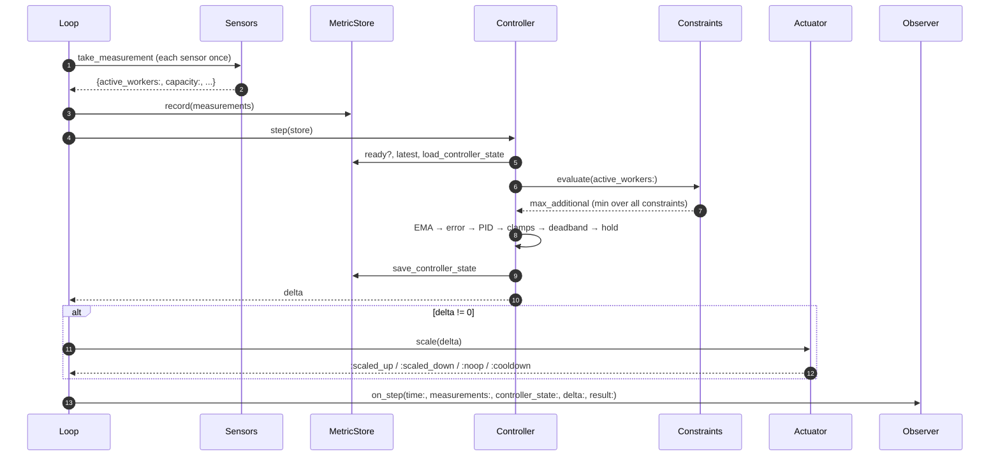
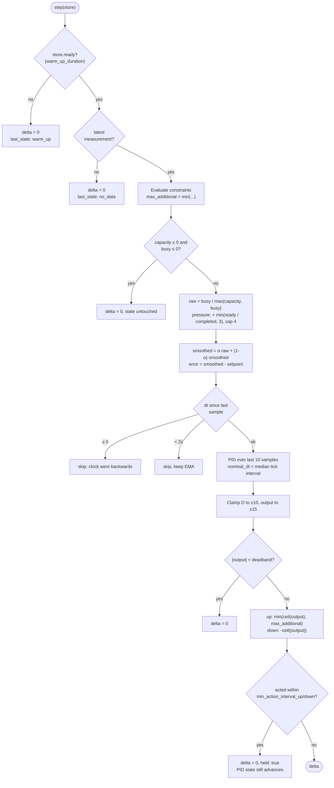
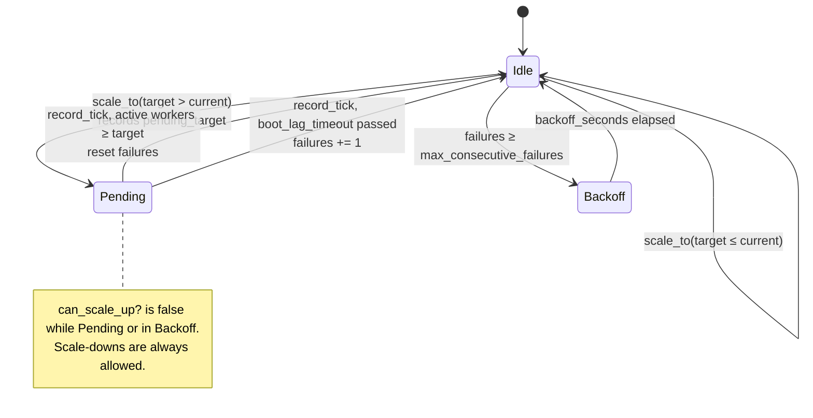
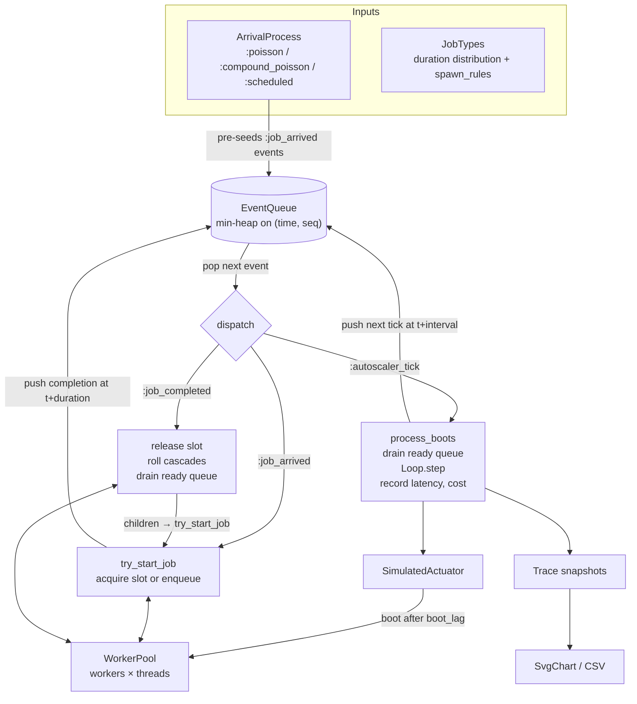

# Skaler

Skaler is a toolkit for building a feedback-controlled autoscaler for background job workers. It has three parts:

- A PID control loop.
- A set of constraints that stop it from scaling past what your infrastructure can take.
- A discrete-event simulator, so you can tune it against your own traffic before production sees it.

It ships sensors for Solid Queue and an actuator for Render. Everything else is plain Ruby, and every piece can be swapped out.

> [!TIP]
> This gem was created for [Cora,](https://cora.computer/)
> your personal e-mail assistant.
> Send them some love for allowing me to share it.

## Skaler is a kit, not a product

You will not find `Skaler.configure { max_instances 20 }` here, and that is deliberate.

An autoscaler that works is dangerous. Each instance it adds opens database connections, Redis clients and API sessions, and runs queries against the same database your web traffic reads from. Which of these runs out first, and at what fleet size, depends on _your_ setup: your connection pooler, your Redis plan, your thread count, and whatever else shares those resources. Generic defaults would be tuned for somebody else's bottleneck, and the gem cannot know yours.

So Skaler gives you small parts with narrow jobs: sensors, a store, a controller, constraints and an actuator. You wire them together yourself, in a few dozen lines of your own code. That wiring is where you write down what "safe" means for your system: which resources the loop must never exhaust, how fast it may grow, what it does when a reading fails, and how you will see it misbehave.

Expect to spend more time on the constraints and the dashboards than on the PID gains. For a complete worked example, with the reasoning and the incidents behind each choice, see [EXAMPLE_CONFIG.md](EXAMPLE_CONFIG.md).

## Installation

```ruby
# Gemfile
gem "skaler", git: "..."
```

```ruby
require "skaler"               # controller, constraints, stores, Render actuator, simulator
require "skaler/solid_queue"   # Solid Queue / ActiveRecord sensors - needs a booted Rails app
```

The only runtime dependencies are `csv` and `logger`. Redis and Render clients are duck-typed, so you pass in the clients you already have.

## What we learned building it

Skaler is the fourth autoscaler written for Cora's background workers. Each earlier one failed in a different way, and most of the design follows from those failures. Some of these lessons apply to autoscaling in general, not only to Skaler. [EXAMPLE_CONFIG.md](EXAMPLE_CONFIG.md) tells the Cora-specific version of the story.

### 1. Measure occupancy, not CPU

Job workers are mostly I/O-bound. A worker waiting on an HTTP call or a database query looks idle to a CPU meter while every one of its threads is busy. Scaling on CPU removes capacity exactly when the queue is about to explode.

Skaler's basic signal is **thread occupancy**, `busy / capacity`. For job workers this plays the same role that request queue time plays for web servers.

### 2. Occupancy stops at 100%, so add the backlog

Occupancy cannot go above 1.0. A saturated fleet with ten jobs waiting and a saturated fleet with ten thousand waiting give the same reading. If your setpoint is 0.85 and the fleet sits at 0.85, the controller sees no error and does nothing while the queue grows. That actually happened, with 1,220 ready jobs.

The obvious fix, `(busy + ready) / capacity`, has no upper bound. One large burst of scheduled jobs then produces a huge error, and the fleet swings between its floor and its ceiling.

Skaler's `"pressure"` mode adds a bounded backlog term instead: `min(ready / completed_since_last_tick, 3)`. This is "how many ticks it would take to drain the queue at the current throughput", and the total signal is capped at 4. It grows with the backlog, but it can't run away.

### 3. Clean the signal before you control on it

Most of the noise in a production reading comes from the _denominator_, not the numerator. Workers that are booting or shutting down make the capacity reading jump between consecutive ticks, for example from 15 to 120 for the same workload. Skaler handles this in three ways:

- **Capacity floor.** Capacity is taken as `max(capacity, busy)`. If N jobs are claimed, at least N threads exist.
- **Skip empty ticks.** A tick with zero capacity and zero busy threads (a deploy gap) is skipped without touching any state. A single 0.0 fed into the moving average would pull it down sharply, and the derivative term would amplify the drop.
- **EMA smoothing.** The smoothing factor `smoothing_alpha` trades noise rejection against response time. Find the knee of that curve in the simulator rather than guessing it.

### 4. Account for boot time

New instances take minutes to start doing work. A naive loop sees "still overloaded" on the next tick and orders more, then more again, and then has to throw most of them away. This is a classic limit cycle.

Skaler handles this in three places:

- The executor remembers each pending scale-up and refuses another one until the instances actually appear.
- If they never appear, it counts a failure. After several failures in a row it stops scaling up for a while, because "the provider isn't giving me instances" calls for a person to look, not a retry loop.
- The controller can **observe fast and act slowly**. `min_action_interval_up` keeps computing the PID on every tick, so the moving average and the integral stay current, but only lets it act once new capacity has had time to become useful.

### 5. A stateless loop must store its memory somewhere

The loop usually runs as a recurring job on whichever worker picks it up, so every tick starts with fresh objects. If the controller kept its history in memory, the integral would always be empty and the derivative would be meaningless. Your PID would quietly become a P controller with an inflated gain.

Skaler keeps the moving average, the error history and the last action time in the `MetricStore`, and loads and saves them on every step. The controller object itself holds nothing between ticks.

### 6. Ticks are irregular

A job scheduled every 15 seconds runs late when the system is busy, which is exactly when the autoscaler matters most. A textbook PID assumes evenly spaced samples. With irregular ones, the derivative overreacts to late ticks and the integral underweights long gaps.

Skaler's PID weights each sample by the time it actually covers, and normalizes by the _median_ observed interval. The same gains therefore work at 15s or 60s ticks. Ticks that arrive less than 2s apart, or that go backwards in time, are skipped.

### 7. Asymmetry and floors matter more than gains

Two settings mattered more than any gain tuning:

- **Scale down promptly.** If scale-up and scale-down are gated equally, frequent bursts ratchet the fleet upward. Skaler lets the two directions have different action intervals and cooldowns.
- **Keep a floor and some headroom.** If you scale down aggressively with a floor of one instance and a setpoint near 1.0, the fleet oscillates 1 → 7 → 1 through every burst. A small warm floor and a setpoint below 1.0 let ordinary bursts be absorbed by capacity you already have.

Even bigger was **capacity per instance**. Doubling threads per worker cut latency tenfold and cost by about 45% in simulation, more than any gain change. Tune your worker before you tune the loop.

### 8. The blast radius: autoscaling will find your next bottleneck

The most expensive failures came from the autoscaler working _correctly_: it scaled up to meet demand and used up a resource that other parts of the system share. Database connections, Redis clients and database CPU are each a hard wall shared with your web tier. Some of these lessons were learned through incidents:

- **Every shared resource needs a constraint.** A constraint limits how many instances may be _added_. The controller takes the minimum over all constraints.
- **Per-worker estimates of connection use are only safe when the footprint is fixed.** A database pool behind a pooler has a fixed footprint, so `cap / pool_per_worker` works there. Redis clients do not: connection pools fill lazily, and in production the cost per instance varied about 4.5× between idle and burst. A constant tuned at idle let the fleet exhaust Redis, and a constant tuned on average failed again at the peak. For resources like this, **measure the usage and hand out only the remaining slack**, as `MeasuredPooledResourceConstraint` does.
- **Put the ceiling below the edge, not on it.** A budget that hands out 100% of `maxclients` guarantees that you reach it. Use a target utilization such as 0.75.
- **Assume the worst when you can't measure.** A missing or unreadable measurement should allow zero new instances. Assuming there is room is how resources get exhausted.
- **Limit the step size.** Constraints see a snapshot taken at the start of the tick. If the loop adds 15 instances in one action, they all start opening connections before the next measurement can see them. `SlewRateConstraint` caps each step.
- **Constraints only stop growth.** They do not shed instances. A fleet that is already over budget stops growing and comes down only as the PID scales down.
- **A wrong ceiling fails silently.** If your code mistakes a pooled database connection for a direct one, it applies the small direct-connection cap, and the autoscaler slowly shrinks the fleet with no error. Make detection of anything environmental explicit, and test it.

### 9. Make it observable, or a failing autoscaler looks healthy

Two incidents went unnoticed for longer than they should have because of the dashboards, not the code:

- **Chart the measurement, not your model.** A chart of `workers × pool_size` showed a comfortable Redis margin while the real client count was at the limit. Plot your estimate and the measured value side by side. When they diverge, your constants are wrong.
- **Chart the limit too.** Usage without the limit next to it gives no sense of how close you are.
- **Gauges hide spikes. Counters don't.** Many metrics backends roll a gauge up to its _last_ sample in each bucket, so an 11-minute saturation disappeared from an hourly chart. Count "ticks spent above target" as a counter and alert on that.
- **Report the numbers the decision used.** Take one reading per tick and use it for both the decision and the gauges. Otherwise the dashboard and the controller can disagree about what happened.

Skaler's `Loop` accepts any observer with `#on_step`, which gets the measurements, the full controller state (PID terms, every constraint's headroom, the reason a tick was skipped) and the result.

### 10. Simulate first, and replay real bursts

Tuning on production traffic is slow and risky. Average load also hides what matters: cron bursts and fan-out. The simulator runs the same controller and constraint classes against a deterministic, seeded model of arrivals, durations, follow-up jobs, boot lag and thread slots. It can replay per-minute enqueue counts exported from your APM, and it reports cost (instance-minutes) and queue latency for each run. Change one thing per run.

### 11. Have an off switch, and fail safe

Run the loop behind a kill switch that takes effect without a deploy. Wrap each step so that an exception means _no scaling this tick_, gets reported, and is not retried in a pile-up. An autoscaler that freezes at its current size is a small incident. One that acts on bad data is a big one.

## How the loop fits together

Each tick, the loop measures the system, compares a process variable with a setpoint, and turns the difference into an instance delta. The delta is limited by constraints, and the actuator carries it out.


| Role | Interface | Shipped implementations |
|------|-----------|-------------------------|
| **Sensor** | `#take_measurement -> Numeric` | `Sensor.from { ... }`, `RedisConnectionsSensor`, `RedisConnectionCapSensor`, `RenderInstancesSensor`, and the Solid Queue sensors below |
| **MetricStore** | `now`, `record`, `recall(over_last:)`, `ready?(min_duration:)`, `latest`, `save_controller_state`, `load_controller_state` | `MemoryMetricStore` (injectable clock), `RedisMetricStore` (sorted set, Redis `TIME` as the clock, so all processes agree) |
| **Controller** | `#step(store) -> Integer`, `#last_state` | `Controller`, wrapping a pure `PidController` |
| **Constraint** | `#evaluate(active_workers:) -> {max_additional:, ...}` | `PooledResourceConstraint`, `MeasuredPooledResourceConstraint`, `MaxInstancesConstraint`, `SlewRateConstraint` |
| **Actuator** | `#scale(delta) -> :scaled_up / :scaled_down / :noop / :cooldown` | `RenderActuator` (via `ScaleExecutor`), `SimulatedActuator` |
| **Observer** | `#on_step(time:, measurements:, controller_state:, delta:, result:)` | `Trace`, or anything you write |

You can replace any row. Examples: a sensor that reads Sidekiq's API, an actuator that patches a Kubernetes Deployment, a store backed by Postgres, a constraint that reads `pg_stat_activity`.

### Solid Queue sensors

`require "skaler/solid_queue"`:

| Sensor | Reads |
|--------|-------|
| `ActiveWorkersSensor` | `SolidQueue::Process` rows of kind `Worker` that sent a heartbeat in the last 5 minutes |
| `ThreadsPerWorkerSensor` | `thread_pool_size` from the newest live worker's metadata. Falls back to 5 |
| `CapacitySensor` | active workers × threads per worker |
| `ClaimedJobsSensor` | `SolidQueue::ClaimedExecution.count`: jobs currently running |
| `ReadyJobsSensor` | ready executions on the queues the live workers serve, minus paused queues |
| `CompletedJobsSensor` | jobs with `finished_at` after a cutoff, which you supply as a callable |
| `PgConnectionsSensor` | active workers × the ActiveRecord pool size |
| `PgConnectionCapSensor` | the Postgres connection cap: high when a pooler is detected (hostname contains `bouncer`, or port 6432), 350 otherwise |

### Sensor names are the contract

A sensor doesn't know its own name. You give it one when you build the sensors hash. The controller reads these keys from `store.latest`:

| Key | Meaning | Falls back to |
|-----|---------|---------------|
| `:active_workers` | instance count, passed to constraints | `0` |
| `:capacity` | total thread slots | `0` |
| `:busy_threads` | occupied slots | `:claimed_jobs` |
| `:ready_jobs` | backlog (pressure mode only) | `:ready_queue_depth` |
| `:completed_jobs` | throughput since the last tick (pressure mode only) | `:completed_since_last` |

You can add other keys. They are stored and passed to the observer, which makes them useful for dashboards.

### One step



### Inside the controller



The deadband matters more than it looks. Widening it from 0.1 to 0.2 cut scaling events from 325 to 42 over a simulated 12 hours, with almost no change in latency.

### Constraints

Each constraint receives the current worker count and returns `{max_additional: Integer, **details}`. The detail keys, such as `headroom_pg`, `headroom_redis` and `redis_utilization`, end up in `last_state` for your dashboards.

| Constraint | Model | Use for |
|------------|-------|---------|
| `PooledResourceConstraint.new(cap:, pool_per_worker:, name:)` | open loop: `cap / pool_per_worker - workers` | resources where each worker takes a fixed, known share, such as a database pool behind a pooler |
| `MeasuredPooledResourceConstraint.new(usage:, cap:, pool_per_worker:, target_utilization:, name:)` | closed loop: `(cap × target - usage) / pool_per_worker`. Allows nothing if a reading is missing | resources whose per-worker footprint grows with load, such as Redis clients |
| `MaxInstancesConstraint.new(max:)` | `max - workers` | a hard ceiling on fleet size, usually set by budget |
| `SlewRateConstraint.new(max_step:)` | constant `max_step` | limiting overshoot between two measurements |

`cap` and `usage` can be integers or callables. Callables are resolved on every evaluation. To add your own, subclass `Skaler::Constraint` and implement `#evaluate(active_workers:)`.

### Actuators

`RenderActuator` turns a delta into a target instance count. It clamps the target to `[min_instances, max_instances]`, applies separate up and down cooldowns, and hands the target to `ScaleExecutor`. The executor keeps its own state in Redis:



Call `executor.record_tick(active_sq_workers:)` before each step, so that arrivals and timeouts are detected.

The Render client is duck-typed. It needs to respond to:

```ruby
client.services                                        # => [#<obj service=#<obj id="srv-..." name="...">>, ...]
client.instance_count(service_id: "srv-...")           # => Integer
client.scale_service(service_id: "srv-...", instance_count: 6)
```

Pass `on_scale: ->(by_n:, direction:, timestamp:) { ... }` to `ScaleExecutor` to emit metrics or notifications for each scale command.

For any other platform, write an actuator: a class with `#scale(delta)` that returns one of the four result symbols. Use `ScaleExecutor` as a template for tracking boot lag.

## Building your own setup

Before you write the wiring, answer these questions. Each answer becomes a line of configuration.

1. **What is the process variable, and what setpoint gives you headroom?** Use occupancy for steady load, or pressure when backlog builds up while the fleet is saturated. Use a setpoint below 1.0.
2. **What do workers share, and what is each one's footprint?** Fixed footprint: use `PooledResourceConstraint`. Footprint that grows with load: measure it and use `MeasuredPooledResourceConstraint` with a target below 1.0.
3. **How fast may the fleet grow?** Set a slew limit, an up-interval at least as long as boot time, and a cooldown.
4. **What are the floor and the ceiling?** The floor is the capacity you keep warm. The ceiling is your budget, or the point where your shared resources run out.
5. **What happens when a reading fails?** The answer should be "nothing scales this tick".
6. **How do you stop it?** You need a kill switch that works without a deploy.
7. **How will you know it is wrong?** Plan the gauges for every reading the decision used, the limit next to each usage figure, a counter of ticks spent near a limit, and an alert on that counter.

A minimal Solid Queue + Render loop, run from a recurring job:

```ruby
require "skaler"
require "skaler/solid_queue"

Skaler.logger = Rails.logger

def autoscale_tick(redis)
  executor = Skaler::ScaleExecutor.new(render_client: my_render_client, redis: redis)
  service_id = executor.find_service_id(service_name: "my-worker") or return
  executor.record_tick(active_sq_workers: Skaler::ActiveWorkersSensor.new.take_measurement)

  clients = redis.info("clients")

  Skaler::Loop.new(
    sensors: {
      active_workers: Skaler::ActiveWorkersSensor.new,
      capacity: Skaler::CapacitySensor.new,
      claimed_jobs: Skaler::ClaimedJobsSensor.new,
      ready_jobs: Skaler::ReadyJobsSensor.new,
      completed_jobs: Skaler::CompletedJobsSensor.new(since: -> { Time.now - 15 })
    },
    store: Skaler::RedisMetricStore.new(redis: redis, key_prefix: "skaler:metrics"),
    controller: Skaler::Controller.new(
      pid: Skaler::PidController.new(kp: 1.0, ki: 0.01, kd: 2.0, deadband: 0.2),
      setpoint: 0.8,
      smoothing_alpha: 0.45,
      metric_mode: "pressure",
      min_action_interval_up: 60,   # roughly your boot time
      min_action_interval_down: 0,
      constraints: [
        Skaler::PooledResourceConstraint.new(
          cap: 500, pool_per_worker: ActiveRecord::Base.connection_pool.size, name: :pg
        ),
        Skaler::MeasuredPooledResourceConstraint.new(
          usage: clients["connected_clients"].to_i, cap: clients["maxclients"].to_i,
          pool_per_worker: 20, target_utilization: 0.75, name: :redis
        ),
        Skaler::SlewRateConstraint.new(max_step: 4),
        Skaler::MaxInstancesConstraint.new(max: 20)
      ]
    ),
    actuator: Skaler::RenderActuator.new(
      executor: executor, service_id: service_id,
      min_instances: 2, max_instances: 20, cooldown_up: 45, cooldown_down: 45
    ),
    observer: MyGaugeReporter.new
  ).step
rescue => e
  report_error(e)
  nil
end
```

The numbers above are placeholders. Replace each one with a value you can justify for your own system, then check it in the simulator. [EXAMPLE_CONFIG.md](EXAMPLE_CONFIG.md) walks through one production setup and explains every value in it.

## The simulator

`Skaler::Simulator` runs the same `Loop`, `Controller` and constraint classes against a simulated job system. Several hours of traffic replay in about a second.



All randomness comes from one seeded `Random`, so a run is deterministic for a given `random_seed`.

### Running it

```sh
bundle exec exe/skaler_sim --help
bundle exec exe/skaler_sim --max-time 2h --rate 730 --kp 1.0 --kd 2.0
```

The run prints peak instances, completed jobs, cost in instance-minutes and queue latency to stderr. It writes `tmp/skaler_trace.svg` and `tmp/skaler_trace.csv`, and opens the SVG in Quick Look on macOS unless you pass `--no-open`. The chart has six stacked panels: instances with scale markers, raw and smoothed signal against the setpoint, arrivals per tick, ready-queue depth, the P/I/D terms, and queue latency on a log scale.

Every flag can also be set as an upper-case environment variable, such as `KP=1.2 MAX_TIME=8h`. Flags take precedence.

| Group | Flags |
|-------|-------|
| Load | `--rate N` (arrivals/min, Poisson), `--cascade F` (chance that a job spawns a follow-up), `--profile CSV`, `--profile-hours N`, `--ingress-csv CSV`, `--durations CSV`, `--burst-ratio F`, `--seed N`, `--max-time 8h` |
| PID | `--kp`, `--ki`, `--kd`, `--setpoint`, `--deadband` |
| Fleet | `--workers N` (initial and minimum), `--max-workers N`, `--threads N` |
| Timing | `--interval 60s`, `--boot-lag 3m`, `--cooldown 45s` |
| Signal | `--mode utilization\|pressure`, `--alpha F` |
| Output | `--output PATH`, `--csv PATH`, `--no-csv`, `--no-open` |

### Sample data

`examples/` contains made-up traffic for a fictional mail-sync app. It is shaped like real production data, so you can try the simulator before you export your own:

| File | Shape |
|------|-------|
| `job_profile_24h.csv` | 12 job classes, about 3M jobs a day. Mostly sub-second jobs, plus a slow digest job and a very slow export |
| `enqueues_per_minute.csv` | 4 hours, one row per minute: a mailbox-sync cron burst every 5 minutes, occasional webhook storms, a slow morning ramp, and a 12-minute digest spike at 08:00 |
| `job_durations.csv` | mean and p90 for the job classes in the ingress file |

```sh
# Steady, averaged load
bundle exec exe/skaler_sim --profile examples/job_profile_24h.csv --max-time 2h

# Bursty replay, which is where the tuning matters
bundle exec exe/skaler_sim --ingress-csv examples/enqueues_per_minute.csv --durations examples/job_durations.csv
```

### Feeding it your own traffic

There are three load models, from least to most realistic:

1. **Synthetic Poisson** (default): `process_email` jobs arrive at `--rate`, and each one spawns a `summarize` job with probability `--cascade`.
2. **24h profile** (`--profile`): an APM background-action export. Each row becomes a job type with a normal duration distribution fitted from mean and p90. Arrival weights are proportional to `count_24h`.
   ```csv
   action,count_24h,mean_ms,p90_ms,p95_ms
   SyncMailboxJob#perform,1210000,640.00,1150.00,1480.00
   FetchMessageJob#perform,540000,410.00,1290.00,1650.00
   ```
3. **Per-minute ingress replay** (`--ingress-csv`, optionally `--durations`): one row per minute and one column per job class. A share of each minute's arrivals (`--burst-ratio`) lands in a burst of about 3 seconds, and the rest are spread across the minute. This reproduces the cron and pub/sub spikes that averaged profiles hide.
   ```csv
   timestamp,SyncMailboxJob,ProcessWebhookJob,FetchMessageJob
   2026-10-12T06:00:00Z,3341,620,1218
   2026-10-12T06:01:00Z,401,551,143
   ```

### From Ruby

```ruby
sim = Skaler::Simulator.new(
  job_types: {
    work: Skaler::JobType.new(name: :work, duration: Skaler::Distribution.new(mean: 1.2, p90: 3.5))
  },
  arrival_process: {mode: :poisson, rate_per_minute: 900, default_type: :work},
  pid_config: {kp: 1.0, ki: 0.01, kd: 2.0, setpoint: 0.8, deadband: 0.2},
  pool_config: {initial_workers: 2, threads_per_worker: 12, min_workers: 2, max_workers: 60},
  constraints: {pg_max: 2000, redis_max: 5000, pg_pool_size: 14, redis_pool_per_worker: 12},
  timing: {autoscaler_interval: 15, boot_lag_seconds: 180, cooldown_seconds: 45, max_time: 4 * 3600},
  smoothing_alpha: 0.45,
  metric_mode: "pressure",
  random_seed: 7
)
trace = sim.run
File.write("trace.svg", Skaler::SvgChart.render(trace, setpoint: 0.8))
```

`Skaler::Builder.simulation(...)` assembles the same loop around a pool and clock you provide, if you want to drive ticks yourself.

### What the simulator leaves out

The simulator models the controller and the open-loop constraints exactly. It does _not_ model:

- your provider's API latency
- separate up/down cooldowns and `min_action_interval_*`
- measured, closed-loop resource usage
- the effect of your fleet on the database it shares with everything else

Use it to compare settings with each other, not to predict production instance counts.

## Development

```sh
bundle install
bundle exec rake test     # minitest, no database or Redis needed
bundle exec standardrb
```

The tests run without Rails. They use a `test "..." do` / `setup do` shim over `Minitest::Test` (in `test/test_helper.rb`) and small in-memory stand-ins for the Solid Queue models, ActiveRecord's DB config and Redis (in `test/support/`). The fakes implement only the query methods the sensors actually call. If a sensor starts using a new one, its test fails right away.
